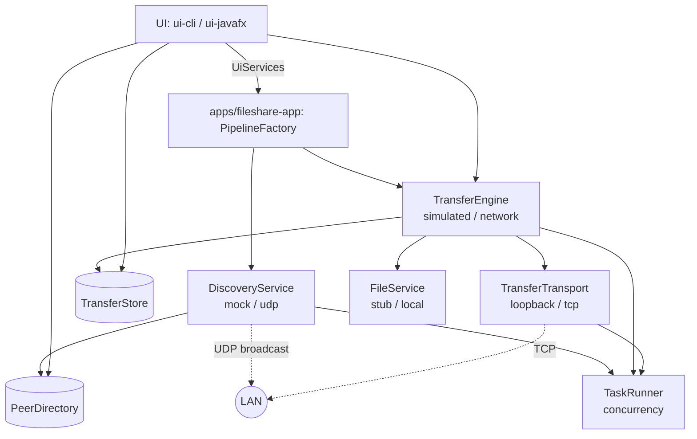

# Architecture Overview

Two communication paths work together: **discovery (UDP)** finds peers, **transfer (TCP)** moves files. Everything
is reached through interfaces ("ports") defined in `modules/contracts`.



## Request lifecycle (real backends)
1. Startup: `AppContext.start()` -> discovery + transfer engine start (TCP listener).
2. Discovery: DISCOVER broadcast -> peers answer -> `PeerDirectory`.
3. User selects peer + file -> `TransferEngine.send(peer, file)` -> session registered in `TransferStore`.
4. Sender opens a `PeerConnection` (transport), sends `TRANSFER_REQUEST` (name, size, SHA-256).
5. Receiver asks the user (`IncomingRequestHandler`) -> `TRANSFER_ACCEPT` / `TRANSFER_REJECT`.
6. Sender streams raw bytes in chunks; receiver writes `<name>.part`.
7. Receiver verifies SHA-256 -> renames to the final name -> `HASH_RESULT` -> `COMPLETED`.
8. Every step publishes the session to `TransferStore`; UIs listen and re-render on the UI thread.

## Module map and ownership (default split)
| Module | Maven module | Typical owner |
|---|---|---|
| M1 Contracts & wiring | `contracts`, `apps/fileshare-app` | Project lead |
| M2 Device discovery | `discovery` | Member 2 |
| M3 TCP & protocol | `network` | Member 3 |
| M4 Transfer engine | `transfer` | Member 4 |
| M5 File services & integrity | `file` | Member 4 (or 5) |
| M6 Concurrency & reliability | `concurrency` (+ reliability work in `transfer`) | Member 5 |
| M7 User interfaces | `ui-cli`, `ui-javafx` | Member 6 |
| M8 Integration, testing, docs | `apps/fileshare-app` tests, `docs` | Everyone |

Ownership is a default, not a wall - anyone can take an unassigned issue.

## Dependency rule
```
contracts  <-  concurrency, discovery, network, file, transfer, ui-cli, ui-javafx   (each depends on contracts only)
all modules <-  apps/fileshare-app                                                  (the only module that sees them all)
```

## Thread model
| Thread / pool | Work |
|---|---|
| JavaFX Application Thread | UI only |
| Discovery listener / scheduler | Receive UDP packets; periodic broadcasts and stale-peer sweep |
| Transport accept thread | Accept incoming connections |
| Transfer workers | One upload/download task per transfer |

All of them are created by `TaskRunner` (`TaskExecutor`). UI updates from workers use `Platform.runLater` or
JavaFX properties.

## Design decisions
See [docs/decisions/](decisions/). In short: one Maven module per concern, records for immutable data, manual wiring
in `PipelineFactory` (no DI framework), no database in the MVP, mock-first backends.
